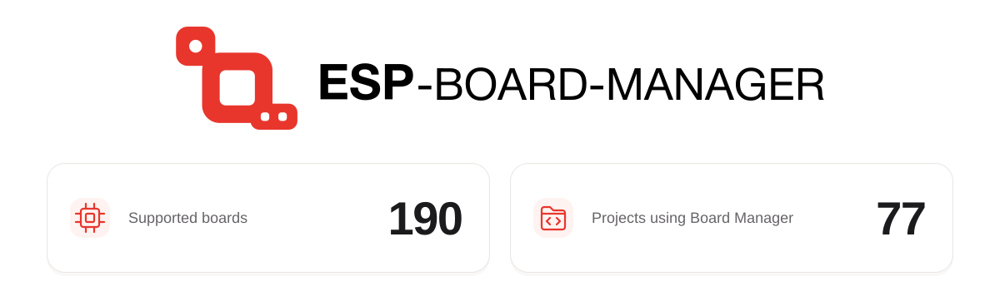

<a href="https://github.com/espressif/esp-board-manager/blob/ecosystem-stats/README.md">
  <picture>
    <source media="(prefers-color-scheme: dark)" srcset="https://raw.githubusercontent.com/espressif/esp-board-manager/ecosystem-stats/ecosystem-banner-en-dark.svg">
    <source media="(prefers-color-scheme: light)" srcset="https://raw.githubusercontent.com/espressif/esp-board-manager/ecosystem-stats/ecosystem-banner-en-light.svg">
    
  </picture>
</a>

# ESP Board Manager

[中文版](README_CN.md)

ESP Board Manager is Espressif's board management component. It uses YAML files to describe the main controller, peripherals, and external devices, then automatically generates board configuration code to simplify board bring-up and application adaptation. Read more in [component's readme](esp_board_manager/README.md).

The component is available on [IDF Component Registry](https://components.espressif.com/components/espressif/esp_board_manager).

Board Manager Web Tool: [https://board-manager.espressif.com](https://board-manager.espressif.com)

Documentation for the latest version: [https://docs.espressif.com/projects/esp-board-manager](https://docs.espressif.com/projects/esp-board-manager)

## Supported Boards

ESP Board Manager supports development boards from different vendors through the following board-pack components:

| Vendor | Board Component | Resources |
| :---: | --- | --- |
|  | `espressif/esp_boards` Official Espressif development boards | [GitHub](https://github.com/espressif/esp-board-manager/tree/main/esp_boards) · [Component Registry](https://components.espressif.com/components/espressif/esp_boards) |
|  | `espressif/esp_friends_boards` Third-party development boards | [GitHub](https://github.com/espressif/esp-board-manager/tree/main/esp_friends_boards) · [Component Registry](https://components.espressif.com/components/espressif/esp_friends_boards) |
|  | `espressif/m5stack_boards` | [GitHub](https://github.com/espressif/esp-board-manager/tree/main/m5stack_boards) · [Component Registry](https://components.espressif.com/components/espressif/m5stack_boards) |
|  | `waveshare/waveshare_boards` | [GitHub](https://github.com/waveshareteam/waveshare_boards) · [Component Registry](https://components.espressif.com/components/waveshare/waveshare_boards) |
|  | `guition/guition_boards` | [GitHub](https://github.com/Guition-JC/Guition) · [Component Registry](https://components.espressif.com/components/guition/guition_boards) |

The `esp_board_manager` component depends on `espressif/esp_boards` by default, so users can list and select these official boards directly with `idf.py bmgr -l`. To use other board-pack components, add the corresponding components to your project dependencies.

To create your own board-pack component, refer to the [board-pack component template](https://github.com/LiuCodee/demo_boards).

## Community and Support

Scan the QR code below with WeChat to join the ESP Board Manager community’s official discussion and support group.

