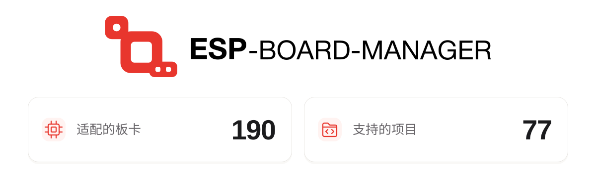

<a href="https://github.com/espressif/esp-board-manager/blob/ecosystem-stats/README.md">
  <picture>
    <source media="(prefers-color-scheme: dark)" srcset="https://raw.githubusercontent.com/espressif/esp-board-manager/ecosystem-stats/ecosystem-banner-zh-dark.svg">
    <source media="(prefers-color-scheme: light)" srcset="https://raw.githubusercontent.com/espressif/esp-board-manager/ecosystem-stats/ecosystem-banner-zh-light.svg">
    
  </picture>
</a>

# ESP Board Manager

[English](README.md)

ESP Board Manager 是乐鑫推出的开发板管理组件。它使用 YAML 文件描述主控、外设和外部功能器件，并自动生成开发板配置代码，从而简化开发板适配、初始化和应用移植流程。更多信息请参阅 [组件说明文档](esp_board_manager/README_CN.md)。

该组件已发布到 [IDF Component Registry](https://components.espressif.com/components/espressif/esp_board_manager)。

Board Manager 网页工具：[https://board-manager.espressif.com](https://board-manager.espressif.com)

最新版本的在线文档：[https://docs.espressif.com/projects/esp-board-manager/zh_CN](https://docs.espressif.com/projects/esp-board-manager/zh_CN)

## 支持的板级

ESP Board Manager 通过以下板级组件支持不同厂商的开发板：

| 厂商 | 板级组件 | 相关链接 |
| :---: | --- | --- |
|  | `espressif/esp_boards` 乐鑫官方开发板 | [GitHub](https://github.com/espressif/esp-board-manager/tree/main/esp_boards) · [组件仓库](https://components.espressif.com/components/espressif/esp_boards) |
|  | `espressif/esp_friends_boards` 第三方开发板 | [GitHub](https://github.com/espressif/esp-board-manager/tree/main/esp_friends_boards) · [组件仓库](https://components.espressif.com/components/espressif/esp_friends_boards) |
|  | `espressif/m5stack_boards` | [GitHub](https://github.com/espressif/esp-board-manager/tree/main/m5stack_boards) · [组件仓库](https://components.espressif.com/components/espressif/m5stack_boards) |
|  | `waveshare/waveshare_boards` | [GitHub](https://github.com/waveshareteam/waveshare_boards) · [组件仓库](https://components.espressif.com/components/waveshare/waveshare_boards) |
|  | `guition/guition_boards` | [GitHub](https://github.com/Guition-JC/Guition) · [组件仓库](https://components.espressif.com/components/guition/guition_boards) |

`esp_board_manager` 默认依赖 `espressif/esp_boards`，可以直接通过 `idf.py bmgr -l` 查看和选择这些官方开发板。使用其他板级组件时，请将对应组件添加到工程依赖中。

如需创建自己的板级组件，可参考 [板级组件模板](https://github.com/LiuCodee/demo_boards)。

## 社区交流与支持

欢迎使用微信扫描下方二维码加入 ESP Board Manager 生态社区的官方交流与支持群。

