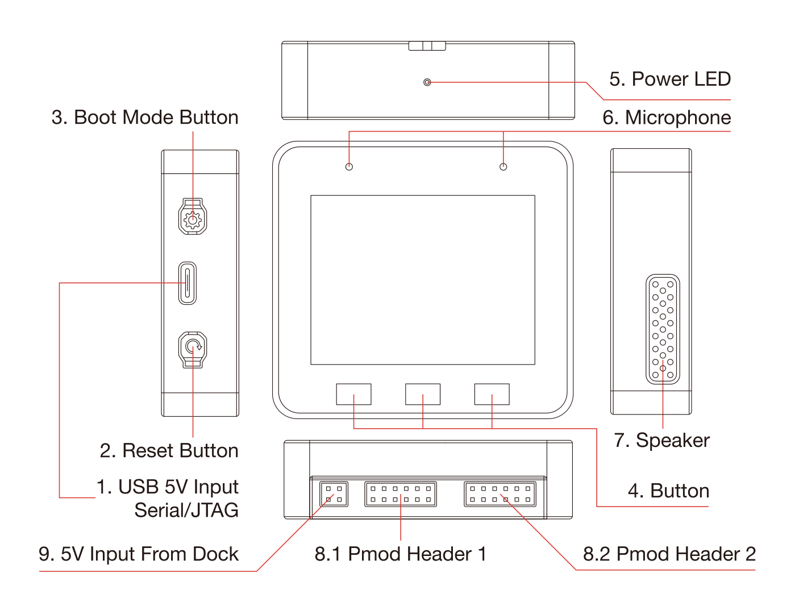
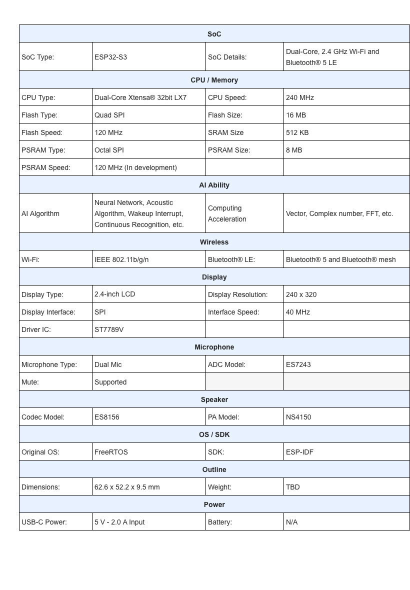
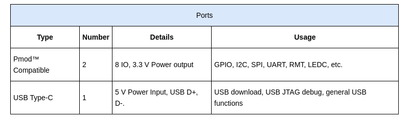

ESP32-S3-BOX-Lite
=================

:link_to_translation:`zh_CN:[中文]`

Hardware Overview
-----------------

   ESP32-S3-BOX-Lite hardware overview

Hardware Source Files
^^^^^^^^^^^^^^^^^^^^^

* `ESP32-S3-BOX-Lite Mainboard Schematic <https://github.com/espressif/esp-box/tree/master/hardware/esp32_s3_box_lite_MB_V1.1/schematic>`__
* `ESP32-S3-BOX-Lite Mainboard PCB <https://github.com/espressif/esp-box/tree/master/hardware/esp32_s3_box_lite_MB_V1.1/pcb>`__
* `ESP32-S3-BOX-Lite Mainboard Gerber <https://github.com/espressif/esp-box/tree/master/hardware/esp32_s3_box_lite_MB_V1.1/gerber>`__
* `ESP32-S3-BOX-Lite Subboard Schematic <https://github.com/espressif/esp-box/tree/master/hardware/esp32_s3_box_lite_MIC_V1.0/schematic>`__
* `ESP32-S3-BOX-Lite Subboard PCB <https://github.com/espressif/esp-box/tree/master/hardware/esp32_s3_box_lite_MIC_V1.0/pcb>`__
* `ESP32-S3-BOX-Lite Subboard Gerber <https://github.com/espressif/esp-box/tree/master/hardware/esp32_s3_box_lite_MIC_V1.0/gerber>`__
* `ESP32-S3-BOX-Lite Shell CAD STEP <https://github.com/espressif/esp-box/tree/master/hardware/esp32_s3_box_lite_shell_step>`__

Specifications:
^^^^^^^^^^^^^^^

   ESP32-S3-BOX-Lite specifications

Ports:
^^^^^^

   ESP32-S3-BOX-Lite interfaces

* `Digilent Pmod™ Interface Specification <https://digilent.com/reference/_media/reference/pmod/pmod-interface-specification-1_3_1.pdf>`__
