

  

# ESP Boards

[English](README.md)

ESP Board Manager 的乐鑫官方板卡定义组件。

乐鑫官方开发板列表请参考：[开发板](https://www.espressif.com/zh-hans/products/devkits)。

**`esp_board_manager` 默认依赖本组件**，因此工程只要添加 `espressif/esp_board_manager`，就会自动获得本组件的所有板子。

本组件提供可被 ESP Board Manager 识别和使用的板级配置文件，包括板子信息、外设及设备配置、板级默认 sdkconfig 等。添加本组件后，可通过 ESP Board Manager 的命令查看板子，或是选中板子生成配置代码。

关于 ESP Board Manager 的更多信息，请参考 [`esp_board_manager` 组件文档](https://github.com/espressif/esp-board-manager/blob/main/esp_board_manager/README_CN.md)。

## 已知兼容性问题

- 本组件 `0.7.3` 及更新版本要求配合 `0.7.6` 或更高版本的 `espressif/esp_board_manager` 使用，以支持通过 `init_level` 配置 GPIO 控制设备的初始化电平。
- 本组件 `0.6.0` 至 `0.7.2` 版本要求配合 `0.7.1` 或更高版本的 `espressif/esp_board_manager` 使用。

## 支持的板级

下表展示音频、SD 卡、显示屏、触摸、摄像头、按键、LED 灯带、旋钮和以太网能力。具体配置及硬件选件请参见板卡配置和对应文档。

### ESP32-S31

| 板卡图片 | 开发板 | 芯片 | 设备能力 |
| :---: | --- | --- | --- |
| <a href="esp32_s31_function_coreboard_1/">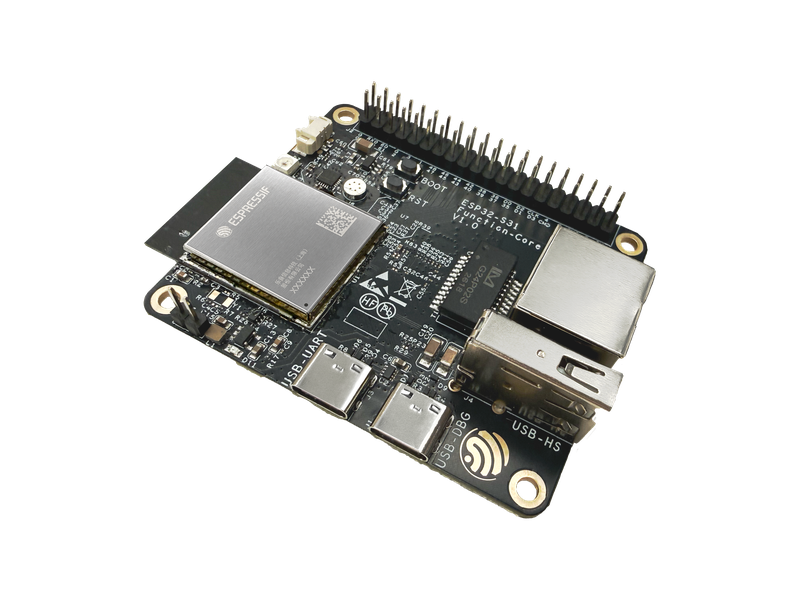</a> | <a href="esp32_s31_function_coreboard_1/">ESP32-S31-Function-CoreBoard-1</a> <code>esp32_s31_function_coreboard_1</code> | ESP32-S31 | <strong>音频</strong>: ES8311 (DAC + ADC) <strong>按键</strong>: GPIO 按键 <strong>LED 灯带</strong>: WS2812 (rmt) <strong>以太网</strong>: YT8531 (RGMII) |
| <a href="esp32_s31_korvo_1/">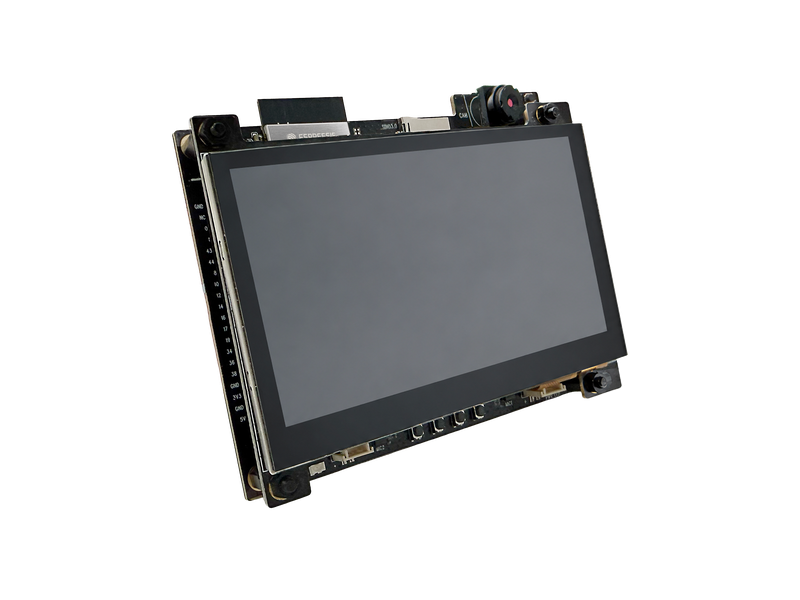</a> | <a href="esp32_s31_korvo_1/">ESP32-S31-Korvo-1</a> <code>esp32_s31_korvo_1</code> | ESP32-S31 | <strong>音频</strong>: ES8389 (DAC + ADC) <strong>SD 卡</strong>: SDMMC <strong>LCD</strong>: RGB LCD (rgb) <strong>LCD 触摸</strong>: GT1151 (i2c) <strong>摄像头</strong>: OV3660/SC101IOT (dvp) <strong>按键</strong>: GPIO 按键 + ADC 按键 <strong>LED 灯带</strong>: WS2812 (rmt) |
| <a href="esp_mosaico/">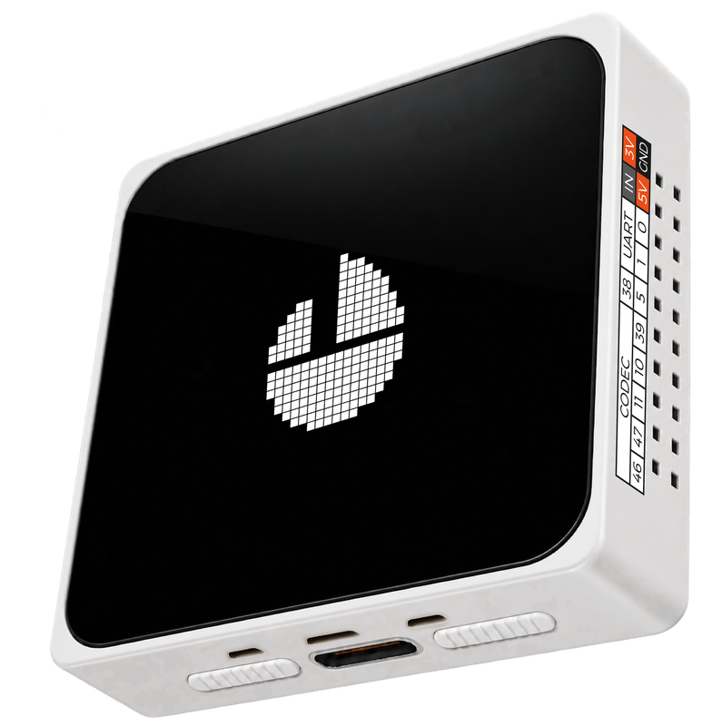</a> | <a href="esp_mosaico/">ESP-Mosaico</a> <code>esp_mosaico</code> | ESP32-S31 | <strong>音频</strong>: ES8311 (DAC + ADC) <strong>LCD</strong>: CO5300 (spi) <strong>LCD 触摸</strong>: CST9220 (i2c) <strong>按键</strong>: GPIO 按键 |

### ESP32-P4

| 板卡图片 | 开发板 | 芯片 | 设备能力 |
| :---: | --- | --- | --- |
| <a href="https://docs.espressif.com/projects/esp-dev-kits/zh_CN/latest/esp32p4/esp32-p4-eye/user_guide.html">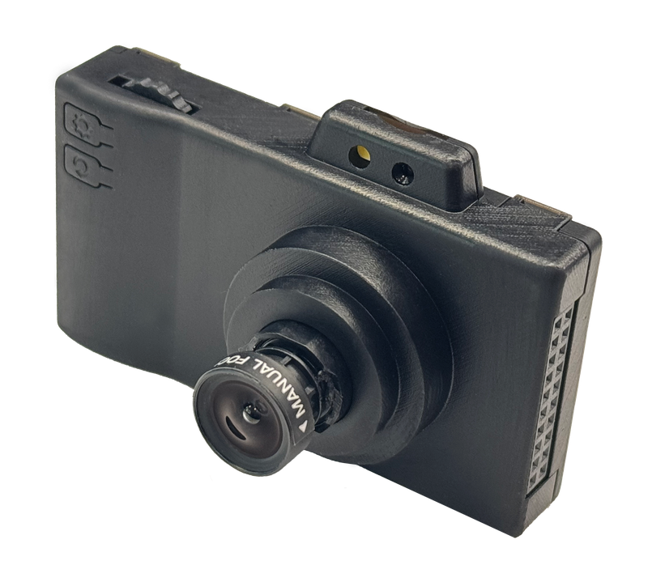</a> | <a href="https://docs.espressif.com/projects/esp-dev-kits/zh_CN/latest/esp32p4/esp32-p4-eye/user_guide.html">ESP32-P4-EYE</a> <code>esp32_p4_eye</code> | ESP32-P4 | <strong>音频</strong>: 内置 ADC <strong>SD 卡</strong>: SDMMC <strong>LCD</strong>: ST7789 (spi) <strong>摄像头</strong>: 摄像头 (csi) <strong>按键</strong>: GPIO 按键 <strong>旋钮</strong>: 旋钮 (gpio) |
| <a href="https://docs.espressif.com/projects/esp-dev-kits/zh_CN/latest/esp32p4/esp32-p4-function-ev-board/user_guide.html">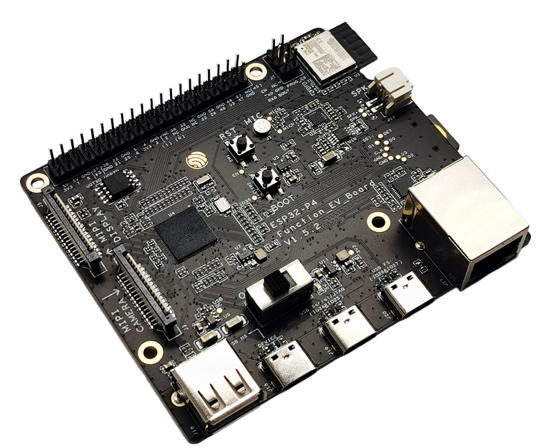</a> | <a href="https://docs.espressif.com/projects/esp-dev-kits/zh_CN/latest/esp32p4/esp32-p4-function-ev-board/user_guide.html">ESP32-P4-Function-EV-Board</a> <code>esp32_p4_function_ev_board</code> | ESP32-P4 | <strong>音频</strong>: ES8311 (DAC + ADC) <strong>SD 卡</strong>: SDMMC <strong>LCD</strong>: EK79007 (dsi) <strong>LCD 触摸</strong>: GT911 (i2c) <strong>摄像头</strong>: 摄像头 (csi) <strong>按键</strong>: GPIO 按键 <strong>以太网</strong>: IP101 (RMII) |
| <a href="esp32_p4x_c5_function_ev/">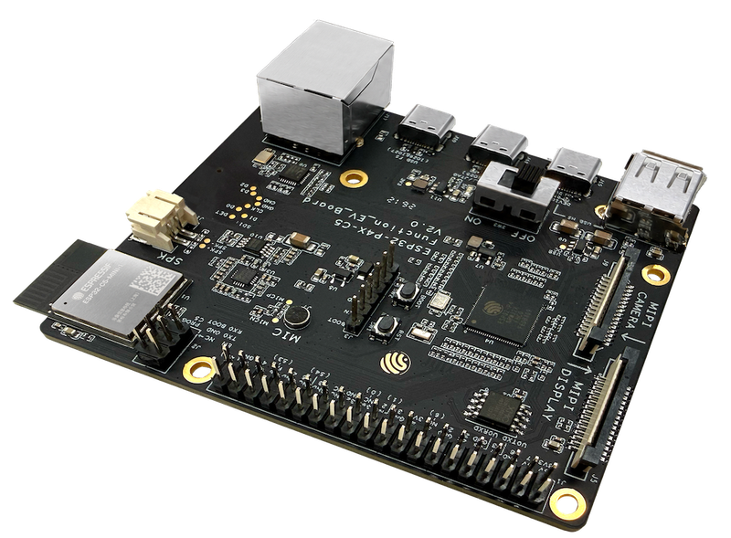</a> | <a href="esp32_p4x_c5_function_ev/">ESP32-P4X-C5-Function-EV-Board</a> <code>esp32_p4x_c5_function_ev</code> | ESP32-P4 | <strong>音频</strong>: ES8311 (DAC + ADC) <strong>SD 卡</strong>: SDMMC <strong>LCD</strong>: EK79007 (dsi) <strong>LCD 触摸</strong>: GT911 (i2c) <strong>摄像头</strong>: 摄像头 (csi) <strong>按键</strong>: GPIO 按键 <strong>以太网</strong>: IP101 (RMII) |

### ESP32-S3

| 板卡图片 | 开发板 | 芯片 | 设备能力 |
| :---: | --- | --- | --- |
| <a href="https://github.com/espressif/esp-box/blob/master/docs/hardware_overview/esp32_s3_box_3/hardware_overview_for_box_3_cn.md">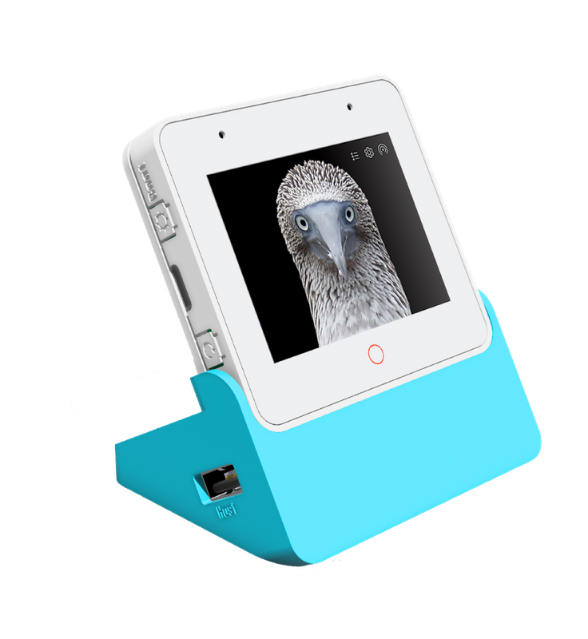</a> | <a href="https://github.com/espressif/esp-box/blob/master/docs/hardware_overview/esp32_s3_box_3/hardware_overview_for_box_3_cn.md">ESP32-S3-BOX-3</a> <code>esp32_s3_box_3</code> | ESP32-S3 | <strong>音频</strong>: ES8311 (DAC) + ES7210 (ADC) <strong>SD 卡</strong>: SDMMC <strong>LCD</strong>: ILI9341 (spi) <strong>LCD 触摸</strong>: GT911/TT21100 (i2c) <strong>按键</strong>: GPIO 按键 |
| <a href="https://github.com/espressif/esp-box/blob/master/docs/hardware_overview/esp32_s3_box_lite/hardware_overview_for_lite.md">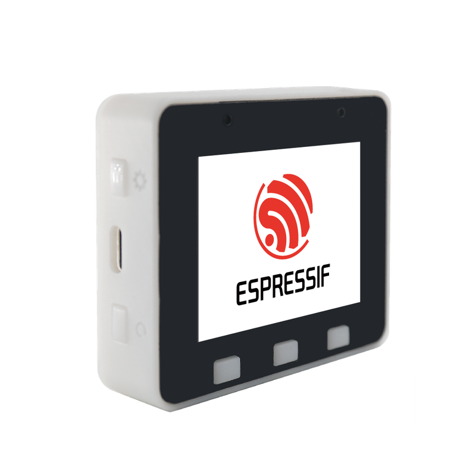</a> | <a href="https://github.com/espressif/esp-box/blob/master/docs/hardware_overview/esp32_s3_box_lite/hardware_overview_for_lite.md">ESP32-S3-BOX-Lite</a> <code>esp32_s3_box_lite</code> | ESP32-S3 | <strong>音频</strong>: ES8156 (DAC) + ES7243E (ADC) <strong>LCD</strong>: ST7789 (spi) <strong>按键</strong>: ADC 按键 + GPIO 按键 |
| <a href="esp32_s3_devkitc_1/">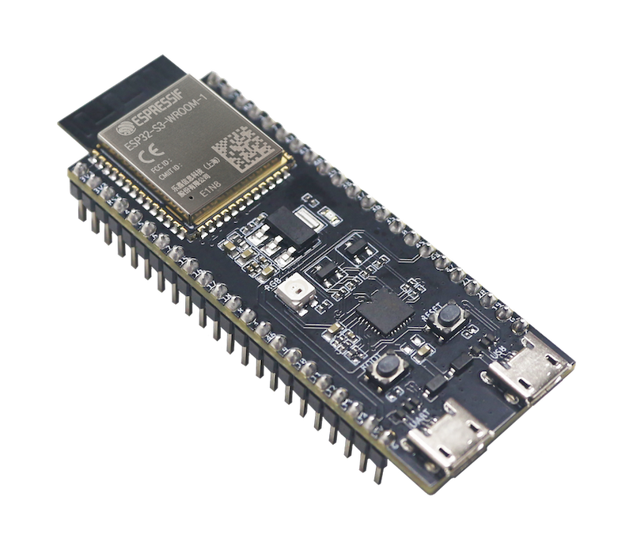</a> | <a href="esp32_s3_devkitc_1/">ESP32-S3-DevKitC-1</a> <code>esp32_s3_devkitc_1</code> | ESP32-S3 | <strong>按键</strong>: GPIO 按键 <strong>LED 灯带</strong>: WS2812 (rmt) |
| <a href="esp32_s3_devkitm_1/">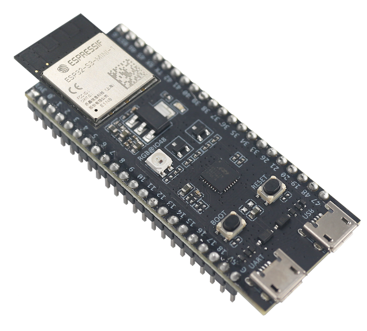</a> | <a href="esp32_s3_devkitm_1/">ESP32-S3-DevKitM-1</a> <code>esp32_s3_devkitm_1</code> | ESP32-S3 | <strong>按键</strong>: GPIO 按键 <strong>LED 灯带</strong>: WS2812 (rmt) |
| <a href="esp32_s3_eye/">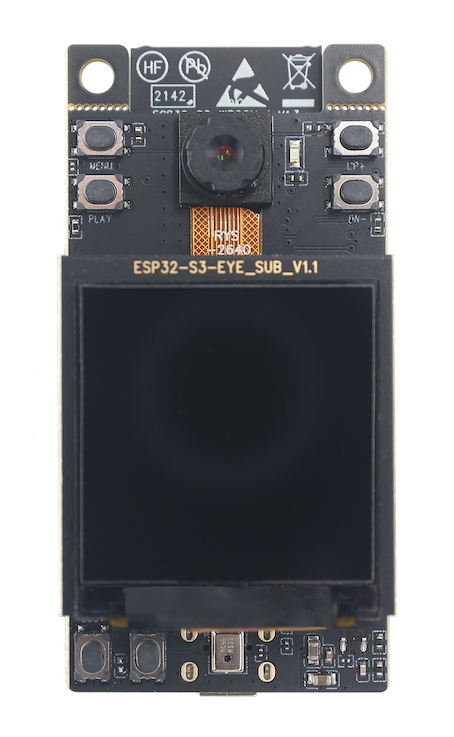</a> | <a href="esp32_s3_eye/">ESP32-S3-EYE</a> <code>esp32_s3_eye</code> | ESP32-S3 | <strong>音频</strong>: 内置 ADC <strong>SD 卡</strong>: SDMMC <strong>LCD</strong>: ST7789 (spi) <strong>摄像头</strong>: 摄像头 (dvp) <strong>按键</strong>: ADC 按键 + GPIO 按键 |
| <a href="esp32_s3_korvo_1/">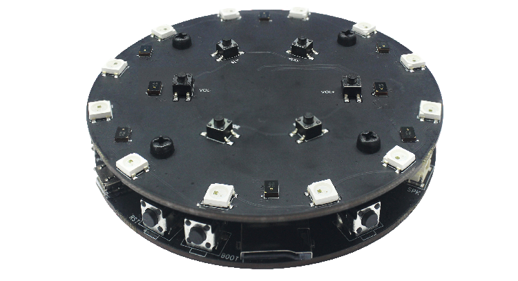</a> | <a href="esp32_s3_korvo_1/">ESP32-S3-Korvo-1</a> <code>esp32_s3_korvo_1</code> | ESP32-S3 | <strong>音频</strong>: ES8311 (DAC) + ES7210 (ADC) <strong>SD 卡</strong>: SDMMC <strong>按键</strong>: ADC 按键 + GPIO 按键 <strong>LED 灯带</strong>: WS2812 (rmt) |
| <a href="https://docs.espressif.com/projects/esp-adf/zh_CN/latest/design-guide/dev-boards/user-guide-esp32-s3-korvo-2.html">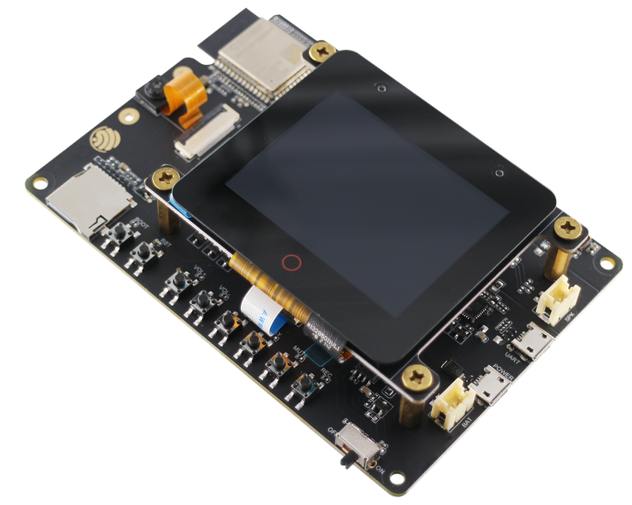</a> | <a href="https://docs.espressif.com/projects/esp-adf/zh_CN/latest/design-guide/dev-boards/user-guide-esp32-s3-korvo-2.html">ESP32-S3-Korvo-2 V3.1</a> <code>esp32_s3_korvo_2_3</code> | ESP32-S3 | <strong>音频</strong>: ES8311 (DAC) + ES7210 (ADC) <strong>SD 卡</strong>: SDMMC <strong>LCD</strong>: ILI9341 (spi) <strong>LCD 触摸</strong>: TT21100/GT911 (i2c) <strong>摄像头</strong>: 摄像头 (dvp) <strong>按键</strong>: ADC 按键 + GPIO 按键 |
| <a href="https://docs.espressif.com/projects/esp-dev-kits/zh_CN/latest/esp32s3/esp32-s3-lcd-ev-board/index.html">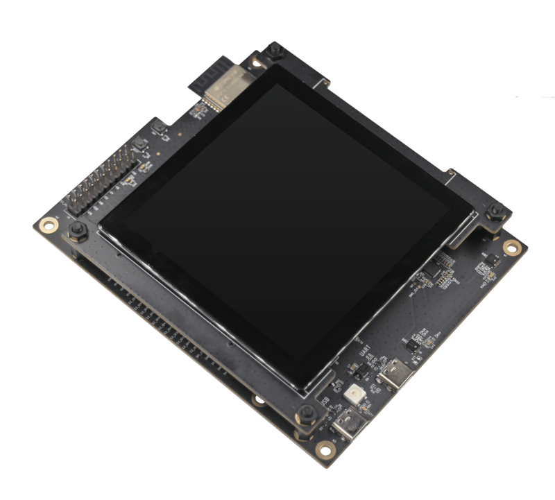</a> | <a href="https://docs.espressif.com/projects/esp-dev-kits/zh_CN/latest/esp32s3/esp32-s3-lcd-ev-board/index.html">ESP32-S3-LCD-EV-Board</a> <code>esp32_s3_lcd_ev_board</code> | ESP32-S3 | <strong>音频</strong>: ES8311 (DAC) + ES7210 (ADC) <strong>LCD</strong>: GC9503 (rgb_3wire_spi) <strong>LCD 触摸</strong>: FT5x06 (i2c) <strong>按键</strong>: GPIO 按键 |
| <a href="esp32_s3_usb_otg/">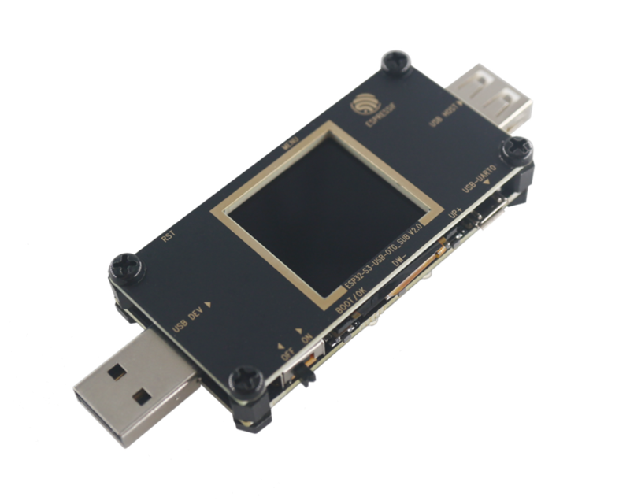</a> | <a href="esp32_s3_usb_otg/">ESP32-S3-USB-OTG</a> <code>esp32_s3_usb_otg</code> | ESP32-S3 | <strong>SD 卡</strong>: SDMMC <strong>LCD</strong>: ST7789 (spi) <strong>按键</strong>: GPIO 按键 |
| <a href="esp_dualkey/">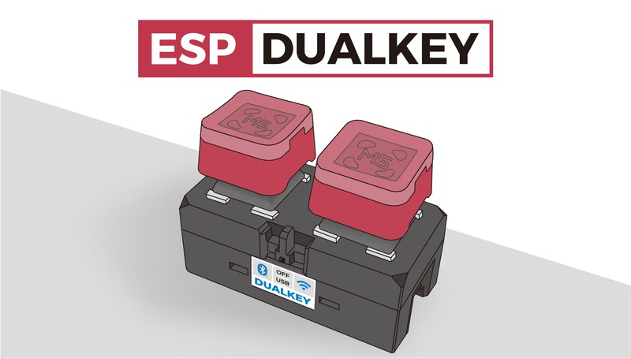</a> | <a href="esp_dualkey/">ESP-DualKey</a> <code>esp_dualkey</code> | ESP32-S3 | <strong>按键</strong>: GPIO 按键 <strong>LED 灯带</strong>: WS2812 (spi) |
| <a href="esp_thread_border_router/">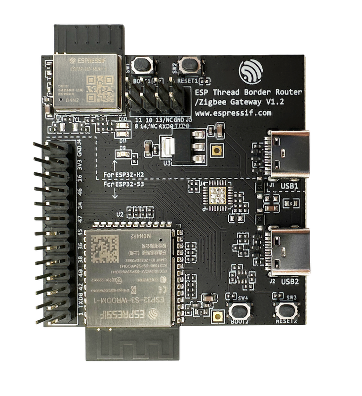</a> | <a href="esp_thread_border_router/">ESP Thread Border Router Board</a> <code>esp_thread_border_router</code> | ESP32-S3 | <strong>按键</strong>: GPIO 按键 |
|  | <a href="https://docs.espressif.com/projects/esp-dev-kits/zh_CN/latest/esp32s3/esp-vocat/user_guide_v1.0.html">ESP-VoCat V1.0</a> <code>esp_vocat_1_0</code> | ESP32-S3 | <strong>音频</strong>: ES8311 (DAC) + ES7210 (ADC) <strong>SD 卡</strong>: SDMMC <strong>LCD</strong>: ST77916 (spi) <strong>LCD 触摸</strong>: CST816S (i2c) <strong>按键</strong>: GPIO 按键 |
| <a href="https://docs.espressif.com/projects/esp-dev-kits/zh_CN/latest/esp32s3/esp-vocat/user_guide_v1.2.html">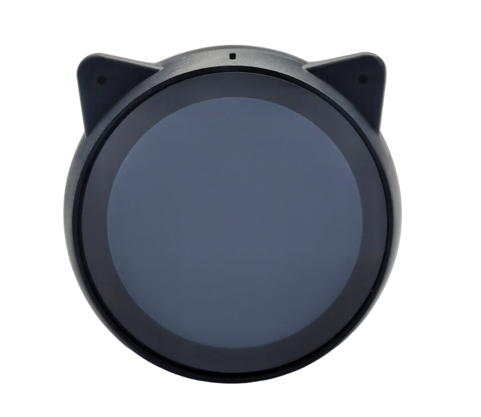</a> | <a href="https://docs.espressif.com/projects/esp-dev-kits/zh_CN/latest/esp32s3/esp-vocat/user_guide_v1.2.html">ESP-VoCat V1.2</a> <code>esp_vocat_1_2</code> | ESP32-S3 | <strong>音频</strong>: ES8311 (DAC) + ES7210 (ADC) <strong>SD 卡</strong>: SDMMC <strong>LCD</strong>: ST77916 (spi) <strong>LCD 触摸</strong>: CST816S (i2c) <strong>按键</strong>: GPIO 按键 |

### ESP32

| 板卡图片 | 开发板 | 芯片 | 设备能力 |
| :---: | --- | --- | --- |
| <a href="esp32_devkitc/">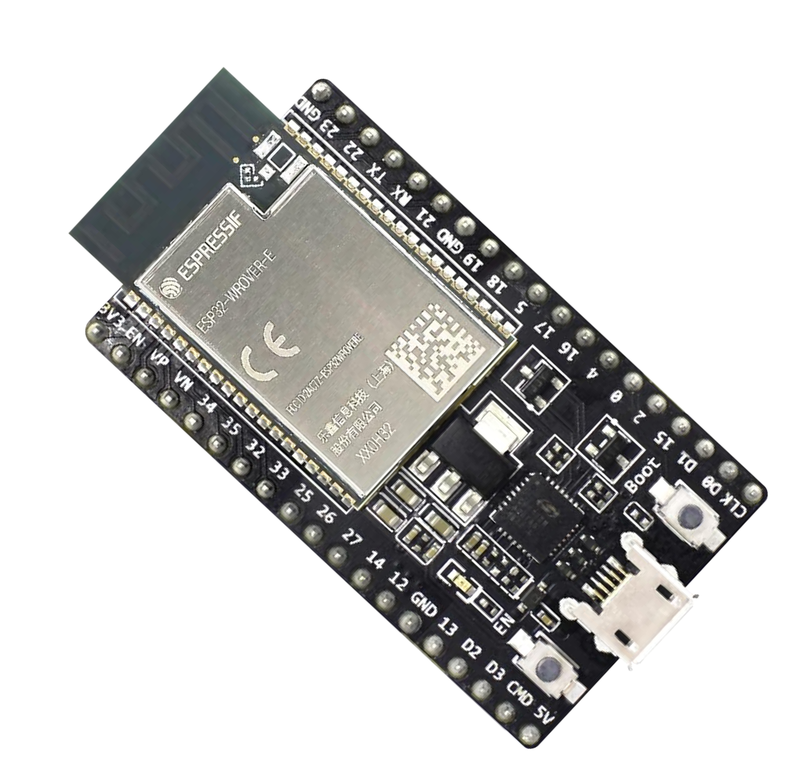</a> | <a href="esp32_devkitc/">ESP32-DevKitC V4</a> <code>esp32_devkitc</code> | ESP32 | <strong>按键</strong>: GPIO 按键 |
| <a href="esp32_devkitm_1/">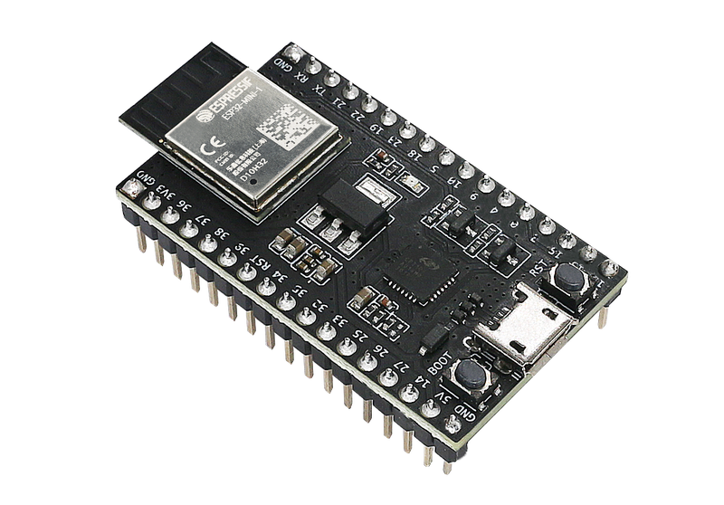</a> | <a href="esp32_devkitm_1/">ESP32-DevKitM-1</a> <code>esp32_devkitm_1</code> | ESP32 | <strong>按键</strong>: GPIO 按键 |
| <a href="esp32_ethernet_kit/">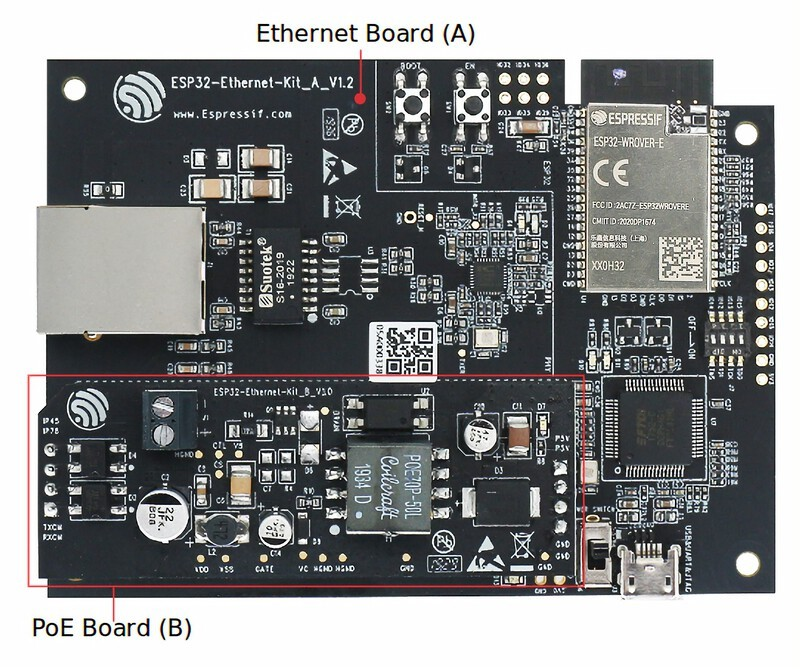</a> | <a href="esp32_ethernet_kit/">ESP32-Ethernet-Kit v1.2</a> <code>esp32_ethernet_kit</code> | ESP32 | <strong>按键</strong>: GPIO 按键 <strong>以太网</strong>: IP101 (RMII) |
| <a href="esp32_lcdkit/">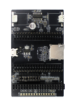</a> | <a href="esp32_lcdkit/">ESP32-LCDKit</a> <code>esp32_lcdkit</code> | ESP32 | <strong>SD 卡</strong>: SDMMC <strong>LCD</strong>: ILI9341 (spi) |
| <a href="https://docs.espressif.com/projects/esp-adf/zh_CN/latest/design-guide/dev-boards/get-started-esp32-lyrat.html">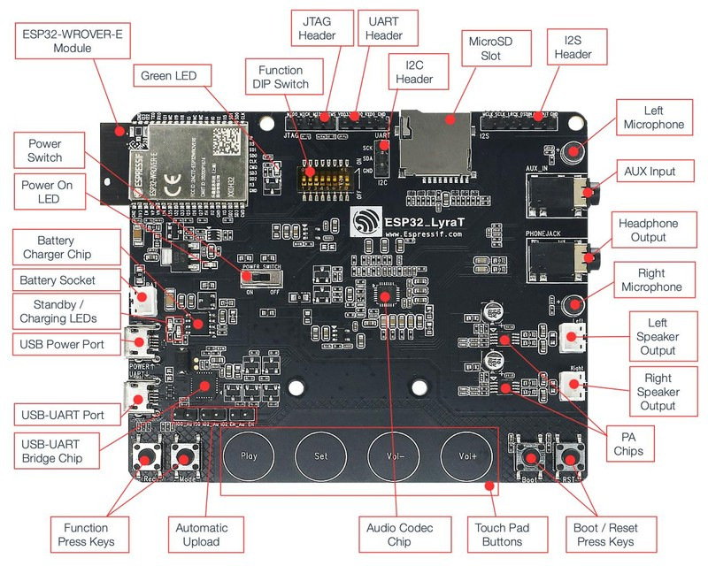</a> | <a href="https://docs.espressif.com/projects/esp-adf/zh_CN/latest/design-guide/dev-boards/get-started-esp32-lyrat.html">ESP32-LyraT V4.3</a> <code>esp32_lyrat_4_3</code> | ESP32 | <strong>音频</strong>: ES8388 (DAC + ADC) <strong>SD 卡</strong>: SDMMC <strong>按键</strong>: GPIO 按键 |
| <a href="https://docs.espressif.com/projects/esp-adf/zh_CN/latest/design-guide/dev-boards/get-started-esp32-lyrat-mini.html">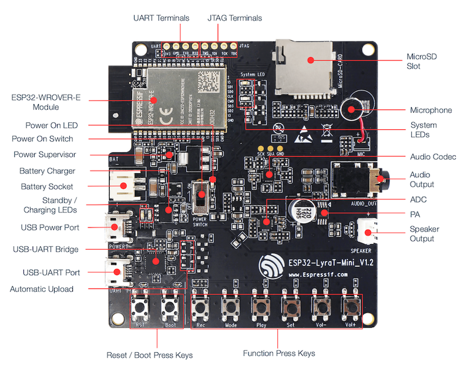</a> 图片展示 LyraT-Mini V1.2；本板卡定义目录为 esp32_lyrat_mini_1_1。 | <a href="https://docs.espressif.com/projects/esp-adf/zh_CN/latest/design-guide/dev-boards/get-started-esp32-lyrat-mini.html">ESP32-LyraT-Mini</a> <code>esp32_lyrat_mini_1_1</code> | ESP32 | <strong>音频</strong>: ES8311 (DAC) + ES7243E (ADC) <strong>SD 卡</strong>: SDMMC <strong>按键</strong>: ADC 按键 + GPIO 按键 |
| <a href="esp32_meshkit_sense/">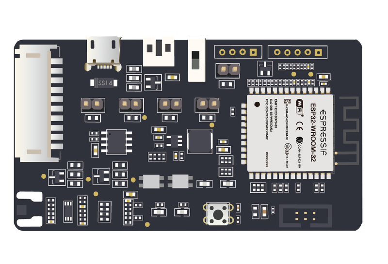</a> | <a href="esp32_meshkit_sense/">ESP32-MeshKit-Sense v1.1</a> <code>esp32_meshkit_sense</code> | ESP32 | <strong>按键</strong>: GPIO 按键 |
| <a href="esp32_pico_devkitm_2/">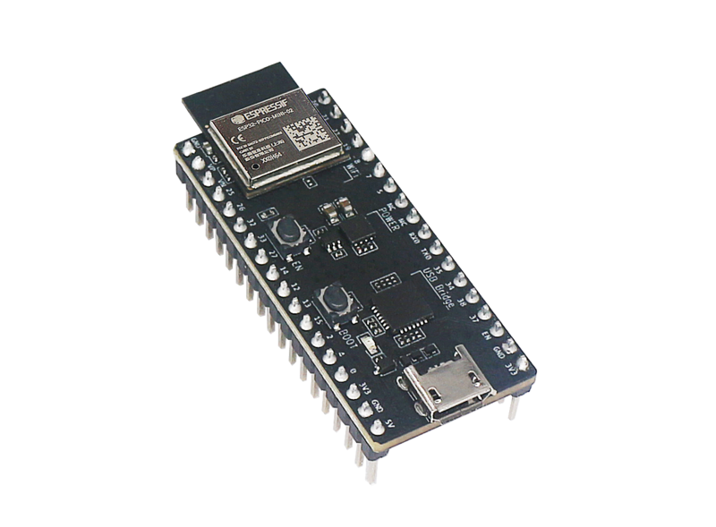</a> | <a href="esp32_pico_devkitm_2/">ESP32-PICO-DevKitM-2</a> <code>esp32_pico_devkitm_2</code> | ESP32 | <strong>按键</strong>: GPIO 按键 |
| <a href="esp32_pico_kit/">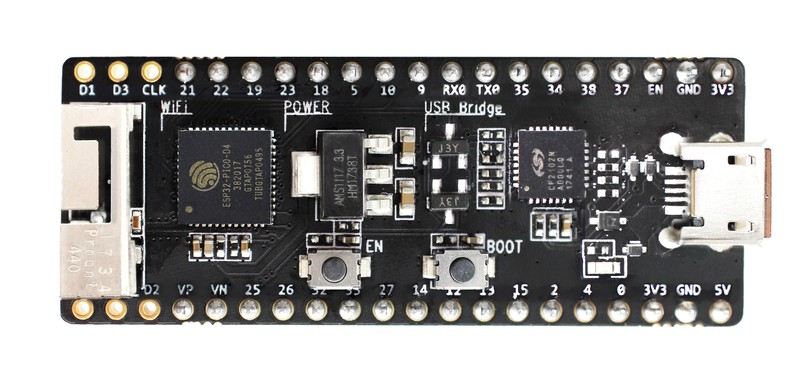</a> | <a href="esp32_pico_kit/">ESP32-PICO-KIT</a> <code>esp32_pico_kit</code> | ESP32 | <strong>按键</strong>: GPIO 按键 |
| <a href="esp32_pico_kit_1/">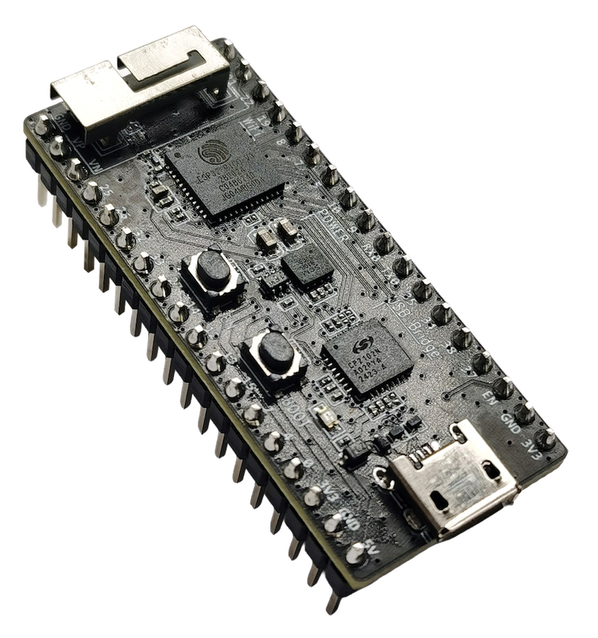</a> | <a href="esp32_pico_kit_1/">ESP32-PICO-KIT-1</a> <code>esp32_pico_kit_1</code> | ESP32 | <strong>按键</strong>: GPIO 按键 |
| <a href="esp32_sense_kit/">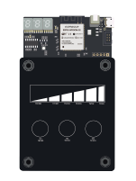</a> | <a href="esp32_sense_kit/">ESP32-Sense-Kit</a> <code>esp32_sense_kit</code> | ESP32 | — |
| <a href="esp32_vaquita_dspg/">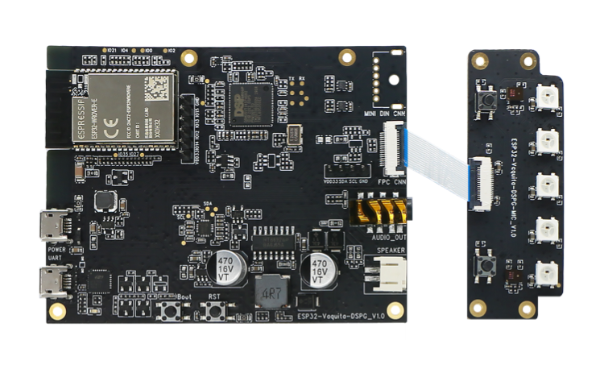</a> | <a href="esp32_vaquita_dspg/">ESP32-Vaquita-DSPG v1.0</a> <code>esp32_vaquita_dspg</code> | ESP32 | <strong>音频</strong>: ES8311 (DAC) <strong>按键</strong>: ADC 按键 + GPIO 按键 <strong>LED 灯带</strong>: WS2812 (rmt) |

### ESP32-C3

| 板卡图片 | 开发板 | 芯片 | 设备能力 |
| :---: | --- | --- | --- |
| <a href="esp32_c3_aws_expresslink_devkit/">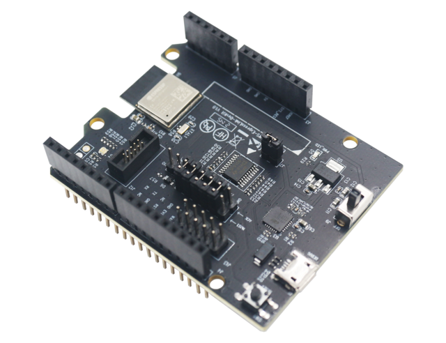</a> | <a href="esp32_c3_aws_expresslink_devkit/">ESP32-C3-AWS-ExpressLink-DevKit</a> <code>esp32_c3_aws_expresslink_devkit</code> | ESP32-C3 | — |
| <a href="esp32_c3_devkit_rust_1/">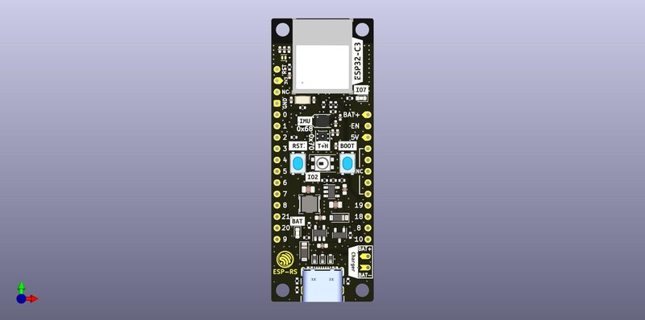</a> | <a href="esp32_c3_devkit_rust_1/">ESP32-C3-DevKit-RUST-1</a> <code>esp32_c3_devkit_rust_1</code> | ESP32-C3 | <strong>按键</strong>: GPIO 按键 <strong>LED 灯带</strong>: WS2812 (rmt) |
| <a href="esp32_c3_devkit_rust_2/">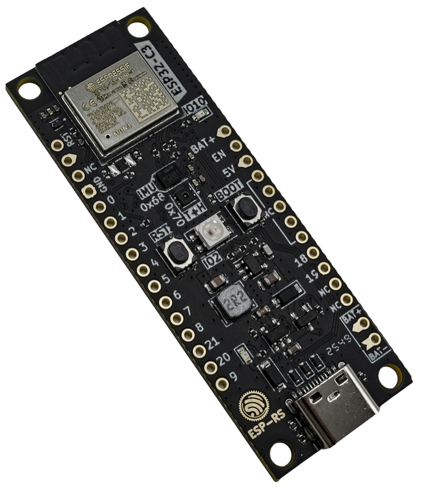</a> | <a href="esp32_c3_devkit_rust_2/">ESP32-C3-DevKit-RUST-2</a> <code>esp32_c3_devkit_rust_2</code> | ESP32-C3 | <strong>按键</strong>: GPIO 按键 <strong>LED 灯带</strong>: WS2812 (rmt) |
| <a href="esp32_c3_devkitc_02/">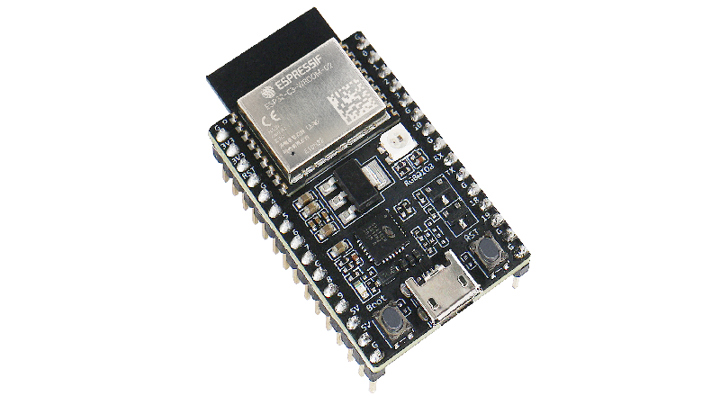</a> | <a href="esp32_c3_devkitc_02/">ESP32-C3-DevKitC-02</a> <code>esp32_c3_devkitc_02</code> | ESP32-C3 | <strong>按键</strong>: GPIO 按键 <strong>LED 灯带</strong>: WS2812 (rmt) |
| <a href="esp32_c3_devkitm_1/">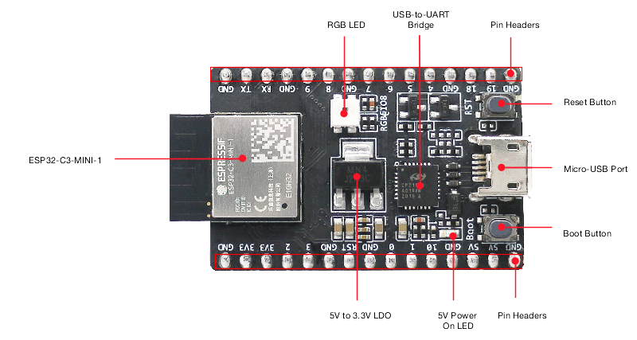</a> | <a href="esp32_c3_devkitm_1/">ESP32-C3-DevKitM-1</a> <code>esp32_c3_devkitm_1</code> | ESP32-C3 | <strong>按键</strong>: GPIO 按键 <strong>LED 灯带</strong>: WS2812 (rmt) |
| <a href="esp32_c3_lcdkit/">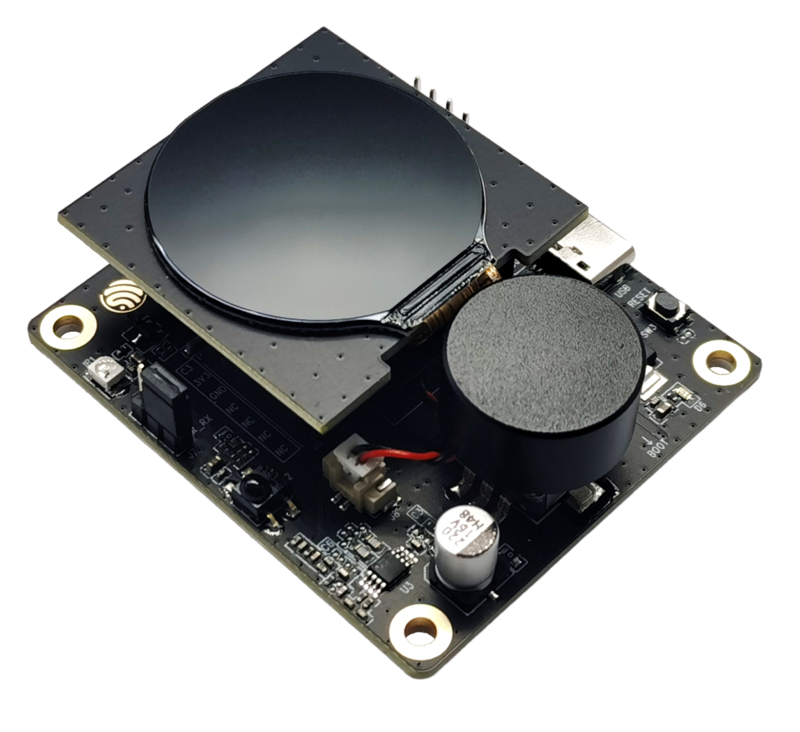</a> | <a href="esp32_c3_lcdkit/">ESP32-C3-LCDKit</a> <code>esp32_c3_lcdkit</code> | ESP32-C3 | <strong>音频</strong>: 内置 DAC <strong>LCD</strong>: GC9A01 (spi) <strong>按键</strong>: GPIO 按键 <strong>LED 灯带</strong>: WS2812 (rmt) <strong>旋钮</strong>: 旋钮 (gpio) |
| <a href="https://docs.espressif.com/projects/esp-adf/zh_CN/latest/design-guide/dev-boards/user-guide-esp32-c3-lyra.html">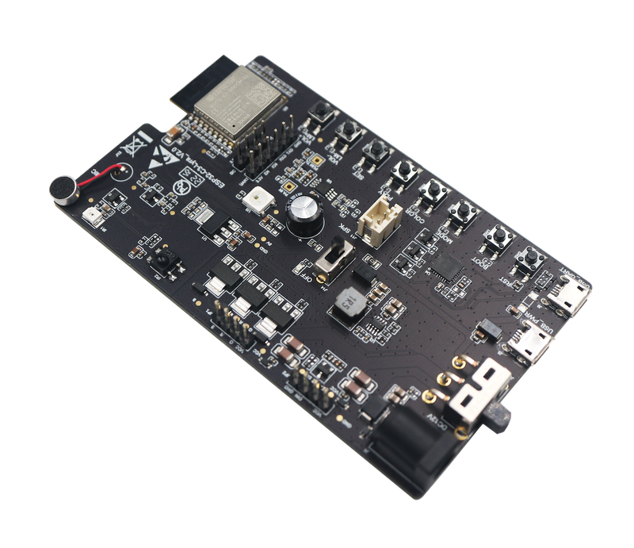</a> | <a href="https://docs.espressif.com/projects/esp-adf/zh_CN/latest/design-guide/dev-boards/user-guide-esp32-c3-lyra.html">ESP32-C3-Lyra</a> <code>esp32_c3_lyra</code> | ESP32-C3 | <strong>音频</strong>: 内置 ADC + DAC <strong>按键</strong>: GPIO 按键 <strong>LED 灯带</strong>: WS2812 (rmt) |

### ESP32-C5

| 板卡图片 | 开发板 | 芯片 | 设备能力 |
| :---: | --- | --- | --- |
| <a href="esp32_c5_devkitc_1/">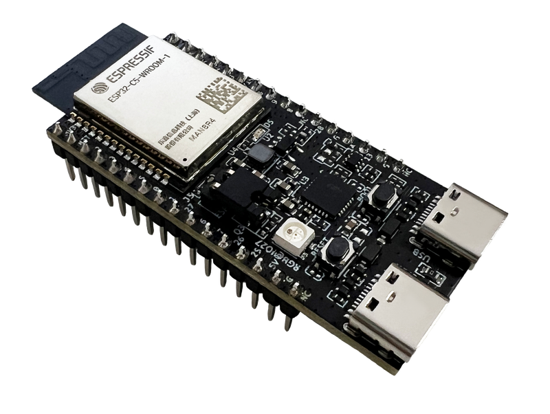</a> | <a href="esp32_c5_devkitc_1/">ESP32-C5-DevKitC-1</a> <code>esp32_c5_devkitc_1</code> | ESP32-C5 | <strong>按键</strong>: GPIO 按键 <strong>LED 灯带</strong>: WS2812 (rmt) |
| <a href="esp_sensairshuttle/">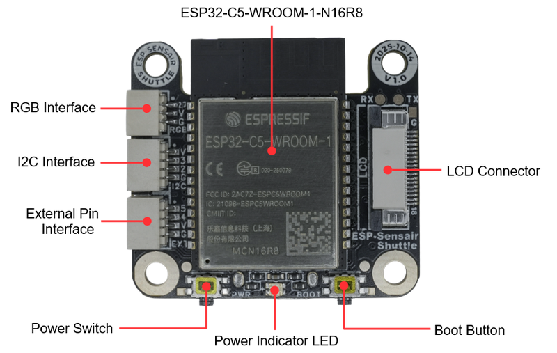</a> | <a href="esp_sensairshuttle/">ESP-SensairShuttle</a> <code>esp_sensairshuttle</code> | ESP32-C5 | <strong>音频</strong>: 内置 DAC + ADC <strong>LCD</strong>: ST7789 (spi) <strong>LCD 触摸</strong>: CST816S (i2c) <strong>按键</strong>: GPIO 按键 <strong>LED 灯带</strong>: WS2812 (rmt) |

### ESP32-C6

| 板卡图片 | 开发板 | 芯片 | 设备能力 |
| :---: | --- | --- | --- |
| <a href="esp32_c6_devkitc_1/">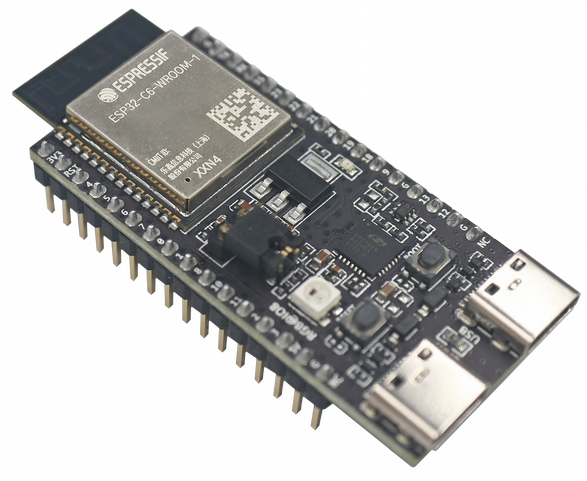</a> | <a href="esp32_c6_devkitc_1/">ESP32-C6-DevKitC-1</a> <code>esp32_c6_devkitc_1</code> | ESP32-C6 | <strong>按键</strong>: GPIO 按键 <strong>LED 灯带</strong>: WS2812 (rmt) |
| <a href="esp32_c6_devkitm_1/">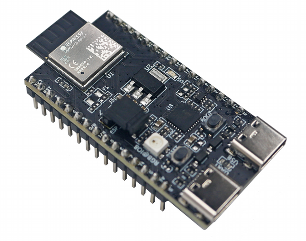</a> | <a href="esp32_c6_devkitm_1/">ESP32-C6-DevKitM-1</a> <code>esp32_c6_devkitm_1</code> | ESP32-C6 | <strong>按键</strong>: GPIO 按键 <strong>LED 灯带</strong>: WS2812 (rmt) |

### ESP32-H2

| 板卡图片 | 开发板 | 芯片 | 设备能力 |
| :---: | --- | --- | --- |
| <a href="esp32_h2_devkitm_1/">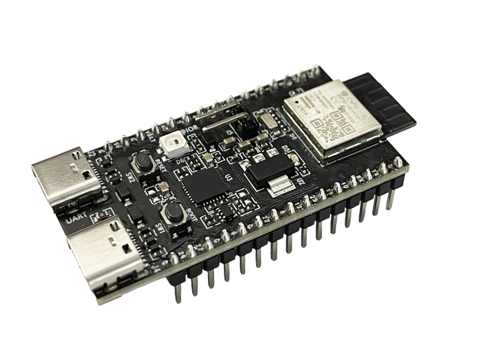</a> | <a href="esp32_h2_devkitm_1/">ESP32-H2-DevKitM-1</a> <code>esp32_h2_devkitm_1</code> | ESP32-H2 | <strong>按键</strong>: GPIO 按键 <strong>LED 灯带</strong>: WS2812 (rmt) |
